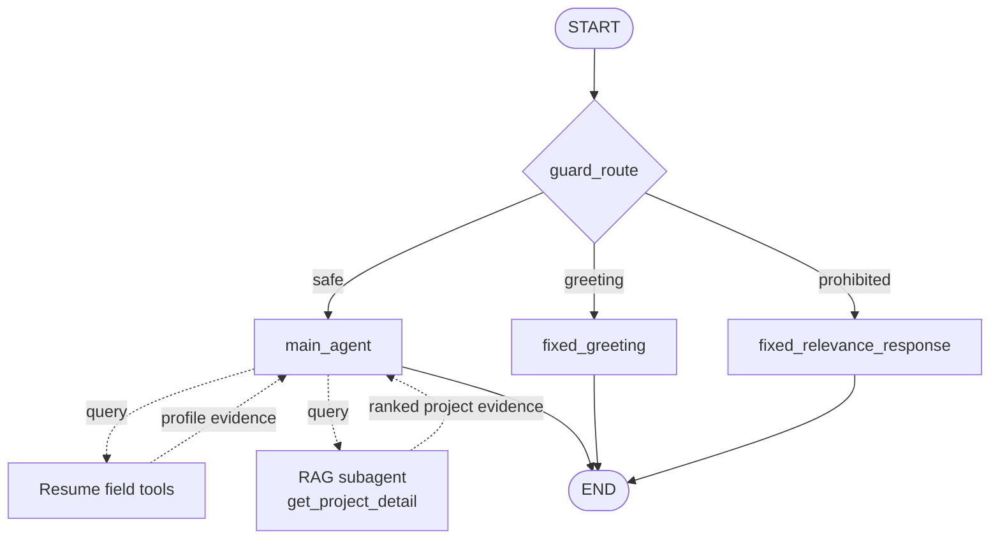

# Interview-Me Assistant

A LangGraph-powered interview assistant that delivers first-person responses grounded exclusively in approved resume and project evidence.

Key capabilities:

- Guarded routing for interview questions, greetings, and prohibited requests
- Evidence-scoped answers from approved resume fields and project records
- Hybrid project retrieval using Chroma, BM25, and reciprocal rank fusion
- Streaming responses in a conversational Streamlit interface

## Quick Start

For a local run, you need Python 3.11 or newer, [uv](https://docs.astral.sh/uv/),
and an OpenRouter API key.

1. Install dependencies and create the environment file:

```bash
cp .env.example .env
uv sync
```

2. Add your API key to `.env`:

```dotenv
OPENROUTER_API_KEY=your-api-key
```

3. Start the application:

```bash
uv run streamlit run src/frontend/app.py
```

Open [http://localhost:8501](http://localhost:8501), enter an interview
question, and watch the grounded response stream into the chat. Conversation
history is retained for follow-up questions during the browser session.

Alternatively, run the application with Docker:

```bash
docker compose up --build
```

The container exposes the same interface at
[http://localhost:8501](http://localhost:8501).

The defaults in `.env.example` configure the main, guard, embedding, and
evaluation models. `GITHUB_USERNAME` is only required when regenerating project
data. Keep `.env` local and never commit it.

To trace graph, agent, tool, and model runs in LangSmith, set
`LANGSMITH_TRACING=true`, `LANGSMITH_API_KEY`, and `LANGSMITH_PROJECT` in `.env`.

The graph entry point is `src.backend.graph:graph`.

## Agent Architecture

The LangGraph workflow has three nodes. `guard_route` is a conditional router
that selects one node based on the conversation.



Solid arrows are LangGraph transitions. Dashed arrows show internal tool routing
within `main_agent`; the tools are not additional graph nodes.

| Graph element              | Type               | Purpose                                                                              |
| -------------------------- | ------------------ | ------------------------------------------------------------------------------------ |
| `guard_route`              | Conditional router | Classifies the conversation as safe, greeting, or prohibited.                        |
| `main_agent`               | LangGraph node     | Routes questions to the appropriate tool and streams a grounded first-person answer. |
| Resume field tools         | Tool               | Return approved profile evidence for general interview questions.                    |
| `get_project_detail`       | Tool               | Runs hybrid Chroma and BM25 search and returns ranked project evidence.              |
| `fixed_greeting`           | LangGraph node     | Returns a deterministic greeting without invoking the main agent.                    |
| `fixed_relevance_response` | LangGraph node     | Returns a deterministic response for prohibited requests.                            |

## Ingest Data (Optional)

The repository includes generated profile and project artifacts. To rebuild
them from a resume and public GitHub repositories, set `GITHUB_USERNAME` and
run:

```bash
uv run python -m src.backend.ingest --regenerate-json
```

This extracts resume text, populates the candidate profile, generates project
summaries, and rebuilds the Chroma and BM25 indexes under `src/backend/data`.

## Project Layout

| Path                  | Purpose                                                            |
| --------------------- | ------------------------------------------------------------------ |
| `src/backend/graph`   | Request routing, main agent, evidence tools, and hybrid retrieval. |
| `src/backend/ingest`  | Resume extraction and GitHub project indexing pipelines.           |
| `src/backend/data`    | Generated profile, project records, and persisted search indexes.  |
| `src/frontend/app.py` | Streamlit chat interface and response streaming adapter.           |
| `tests`               | Deterministic unit and integration tests.                          |
| `eval`                | Golden cases, DeepEval runner, cached results, and reports.        |

## Run the Tests

Run the complete pytest suite from the repository root:

```bash
uv run pytest
```

These tests cover graph routing, artifact cleanup, ingestion, project indexing,
and hybrid project retrieval. The DeepEval workflow below is separate and makes
live model requests.

## Run the Evaluation

The DeepEval suite runs 27 golden interview cases against the graph, then scores
the answers for hallucination, answer relevancy, faithfulness, contextual
precision, and contextual recall. To pass the evaluation, all metrics must meet
the required thresholds (greater than `0.5`). This command makes live model
requests and may incur provider costs.

```bash
uv run eval/eval_agent.py
```

### Recorded baseline

Run on 2026-09-28 with 27 test cases:

| Measure        |   Result |
| -------------- | -------: |
| Test cases     |       27 |
| Passed         |       20 |
| Failed         |        7 |
| Pass rate      |   74.07% |
| Median latency | 11.691 s |
| p95 latency    | 69.168 s |

The full per-case report is available at
[`eval/eval_reports/evaluation_20260928_082553.md`](eval/eval_reports/evaluation_20260928_082553.md).

### Findings

- **Grounding is strong:** hallucination and faithfulness both scored 1.00 with
  a 100% metric pass rate. Answer relevancy averaged 0.95 and passed 26 of 27
  cases.
- **Contextual precision determines the overall result:** all seven failed test
  cases fell below the 0.50 contextual-precision threshold. Four otherwise
  relevant and faithful project answers (`lstm-forecasting-target`,
  `video-slide-report`, `java-server-unsupported-benchmark`, and
  `healthcare-vague-intent`) indicate that retrieval ranking or excess context
  needs improvement.
- **Three failures are evaluation artifacts:** `drought-unknown-accuracy`,
  `fabricated-award`, and `qabot-prompt-injection` returned the exact expected
  refusal and did not hallucinate, but contextual precision and recall scored
  zero. Refusal cases should be evaluated with safety and answer-correctness
  metrics instead of requiring supporting retrieval context.
- **Tail latency is high:** p95 latency was 69.168 seconds versus an 11.691-second
  median, so a small number of graph calls dominate response time. Tracing those
  cases by route, retrieval count, and model duration is the next performance
  priority.

The 74.07% test pass rate therefore understates behavioral correctness: it mixes
genuine retrieval-quality weaknesses with metrics that do not fit no-evidence
refusal cases. Future baselines should report retrieval cases and refusal cases
separately.

### Next priorities

1. Improve project ranking and reduce excess context for the four genuine
   contextual-precision failures.
2. Score refusal cases with safety and answer-correctness metrics instead of
   retrieval-context metrics.
3. Trace slow routes and model calls to reduce p95 latency.
