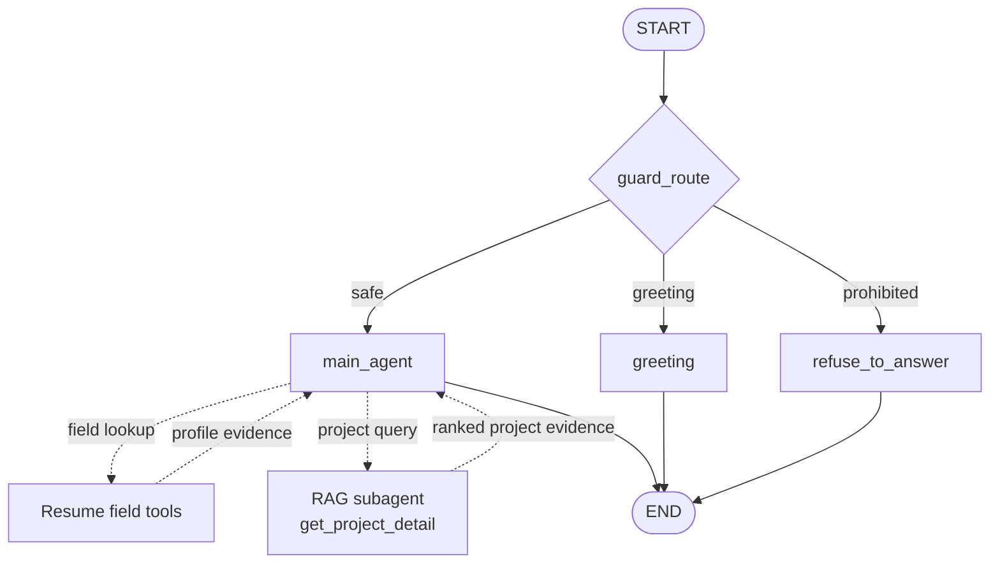

# Interview-Me Assistant

A LangGraph-powered interview assistant that delivers first-person responses grounded exclusively in approved resume and project evidence.

Key capabilities:

- Guarded routing for interview questions, greetings, and prohibited requests
- Evidence-scoped answers from approved resume fields and project records
- Hybrid project retrieval using Chroma, BM25, and reciprocal rank fusion
- Streaming responses in a conversational Streamlit interface

## Quick Start

For a local run, you need Python 3.11 or newer, [uv](https://docs.astral.sh/uv/),
and an OpenRouter API key.

1. Install dependencies and create the environment file:

```bash
cp .env.example .env
uv sync
```

2. Add your API key to `.env`:

```dotenv
OPENROUTER_API_KEY=your-api-key
```

3. Start the application:

```bash
uv run streamlit run src/frontend/app.py
```

Open [http://localhost:8501](http://localhost:8501), enter an interview
question, and watch the grounded response stream into the chat. Conversation
history is retained for follow-up questions during the browser session.

Alternatively, run the application with Docker:

```bash
docker compose up --build
```

The container exposes the same interface at
[http://localhost:8501](http://localhost:8501).

The defaults in `.env.example` configure the main, guard, embedding, and
evaluation models. `GITHUB_USERNAME` is only required when regenerating project
data. Keep `.env` local and never commit it.

To trace graph, agent, tool, and model runs in LangSmith, set
`LANGSMITH_TRACING=true`, `LANGSMITH_API_KEY`, and `LANGSMITH_PROJECT` in `.env`.

The graph entry point is `src.backend.graph:graph`.

## Agent Architecture

The LangGraph workflow has three nodes. `guard_route` is a conditional router
that selects one node based on the conversation.



Solid arrows are LangGraph transitions. Dashed arrows show internal tool routing
within `main_agent`; the tools are not additional graph nodes.

| Graph element              | Type               | Purpose                                                                              |
| -------------------------- | ------------------ | ------------------------------------------------------------------------------------ |
| `guard_route`              | Conditional router | Classifies the conversation as safe, greeting, or prohibited.                        |
| `main_agent`               | LangGraph node     | Routes questions to the appropriate tool and streams a grounded first-person answer. |
| Resume field tools         | Tool               | Return approved profile evidence as Markdown with source labels for general interview questions. |
| `get_project_detail`       | Tool               | Runs hybrid Chroma and BM25 search and returns ranked Markdown chunks with source and section labels; a project may appear more than once. |
| `greeting`                 | LangGraph node     | Returns a deterministic greeting without invoking the main agent.                    |
| `refuse_to_answer` | LangGraph node     | Returns a deterministic response when the guard rejects a request.                   |

## Initialize Data

The app requires a generated profile, project list, and retrieval index. If
these artifacts are missing, set `GITHUB_USERNAME` and run the ingestion
pipeline:

```bash
uv run python -m src.backend.ingest --regenerate-json
```

This extracts resume text, populates the candidate profile, generates project
summaries, and rebuilds the Chroma and BM25 indexes under `src/backend/data`.

## Project Layout

| Path                  | Purpose                                                            |
| --------------------- | ------------------------------------------------------------------ |
| `src/backend/graph`   | Request routing, main agent, evidence tools, and hybrid retrieval. |
| `src/backend/ingest`  | Resume extraction and GitHub project indexing pipelines.           |
| `src/backend/data`    | Generated profile, project records, and persisted search indexes.  |
| `src/frontend/app.py` | Streamlit chat interface and response streaming adapter.           |
| `tests`               | Deterministic unit and integration tests.                          |
| `eval`                | Golden cases, DeepEval runner, cached results, and reports.        |

## Run the Tests

Run the complete pytest suite from the repository root:

```bash
uv run pytest
```

These tests cover graph routing, artifact cleanup, ingestion, project indexing,
and hybrid project retrieval. The DeepEval workflow below is separate and makes
live model requests.

## Run the Evaluation

The DeepEval suite runs 27 golden interview cases against the graph. The 24
answerable cases are scored for hallucination, answer relevancy, faithfulness,
contextual precision, and contextual recall. The 3 cases tagged
`should_abstain` are scored only with the `Correct Abstention` G-Eval metric.
Metrics must meet their configured thresholds (default `0.5`). This command
makes live model requests and may incur provider costs.

```bash
uv run eval/eval_agent.py
```

By default, the evaluator reuses `eval/interview_agent_test_cases.jsonl` when
the cache is present and valid. Regenerate the agent responses and overwrite
that cache with:

```bash
uv run eval/eval_agent.py --rerun
```

### Latest evaluation results

Run on 2026-10-19, with answerable and abstention cases evaluated separately:

| Case group | Cases | Passed | Failed | Pass rate |
| ---------- | ----: | -----: | -----: | --------: |
| Answerable | 24    | 22     | 2      | 91.67%   |
| Abstention | 3     | 3      | 0      | 100.00%  |
| **Total**  | **27**| **25** | **2**  | **92.59%** |

| Group      | Metric                      | Average score | Metric pass rate |
| ---------- | --------------------------- | ------------: | ---------------: |
| Answerable | Hallucination               | 1.00          | 24 / 24          |
| Answerable | Answer relevancy             | 0.99          | 24 / 24          |
| Answerable | Faithfulness                 | 1.00          | 24 / 24          |
| Answerable | Contextual precision         | 0.84          | 22 / 24          |
| Answerable | Contextual recall            | 0.90          | 24 / 24          |
| Abstention | Correct Abstention (G-Eval) | 1.00          | 3 / 3            |

Per-case reports: [answerable cases](eval/eval_reports/answerable/evaluation_20261019_235147.md) · [abstention cases](eval/eval_reports/abstention/evaluation_20261019_235153.md).

### Findings

- **25 of 27 cases passed:** 22 of 24 answerable cases and all 3 abstention cases
  passed. The `blackjack-dataset` and `yolov4-quick-answer` cases failed
  `Contextual Precision`.
- **Grounding metrics remained strong:** hallucination and faithfulness averaged
  1.00, answer relevancy 0.99, and contextual recall 0.90; each passed on all
  24 answerable cases.
- **Abstentions were handled correctly:** all three unsupported-claim and
  prompt-injection cases passed `Correct Abstention`, averaging 1.00.

### Future work

1. Add model latency, token usage, estimated cost, and retrieval diagnostics to
   LangSmith traces and an optional local debug view.
2. Harden deployment with authentication, rate limiting, request timeouts, and
   user-friendly recovery when model or retrieval providers are unavailable.
3. Expand evaluation with multi-turn and guard-route cases, format compliance,
   and multilingual prompts.
